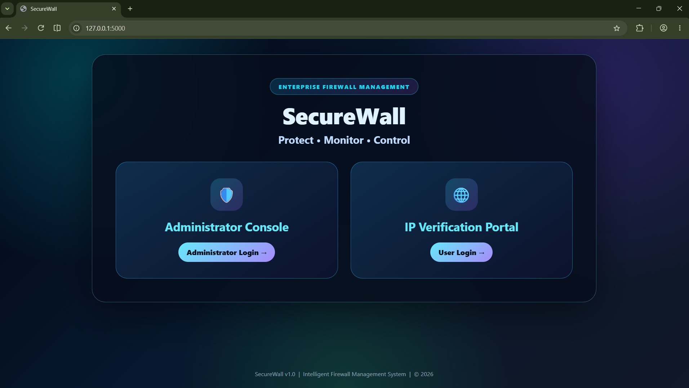
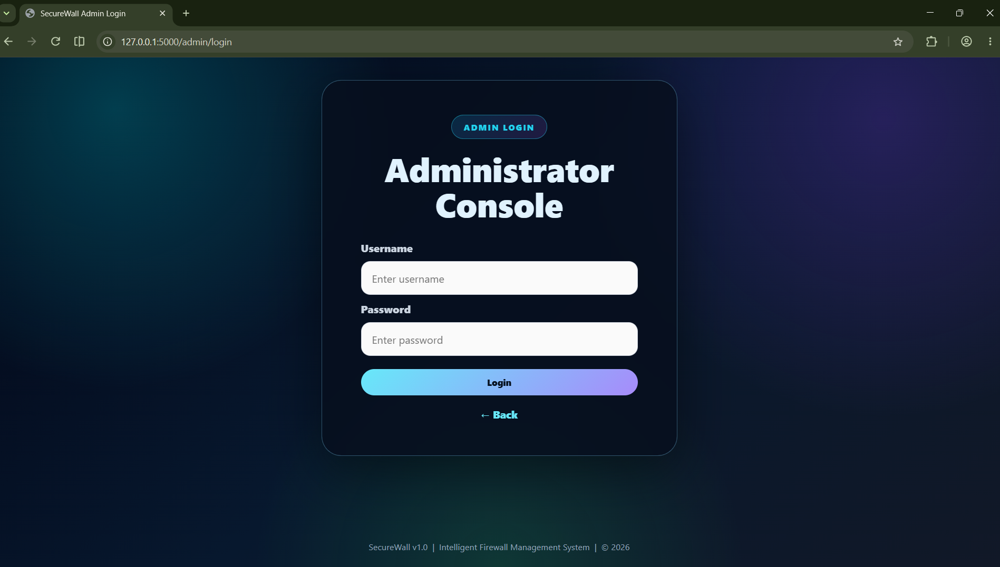
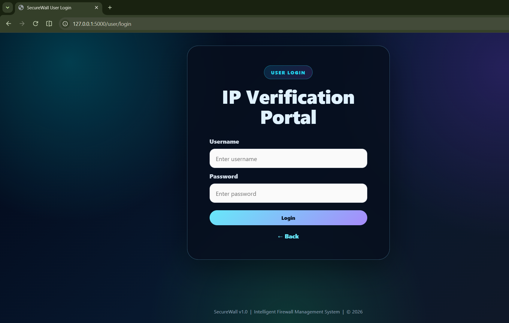
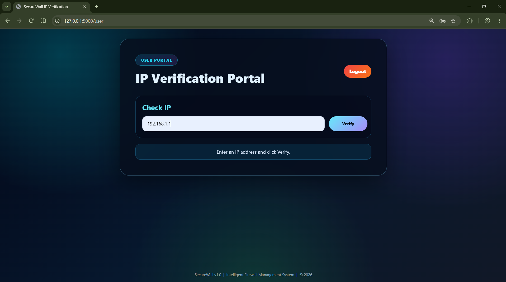
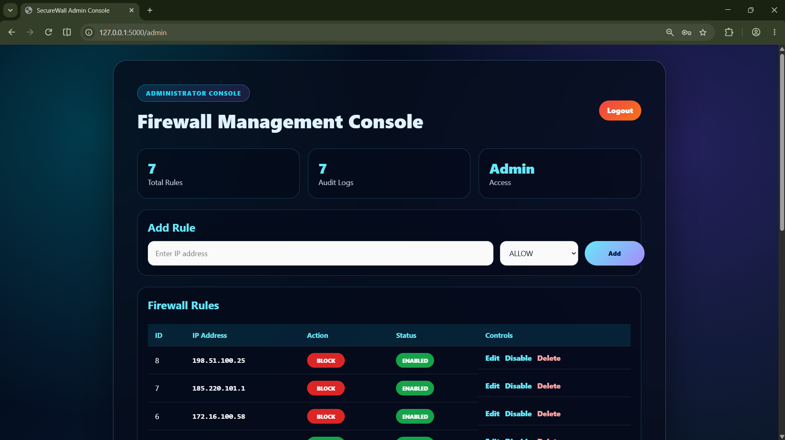
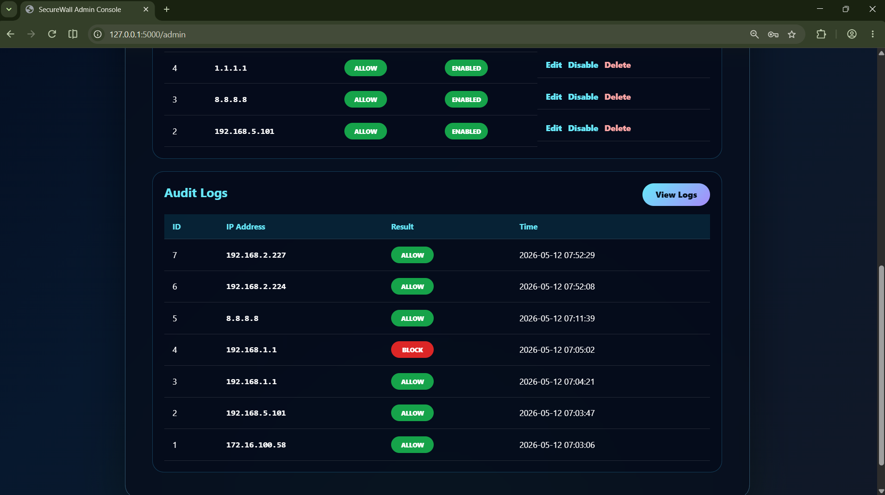
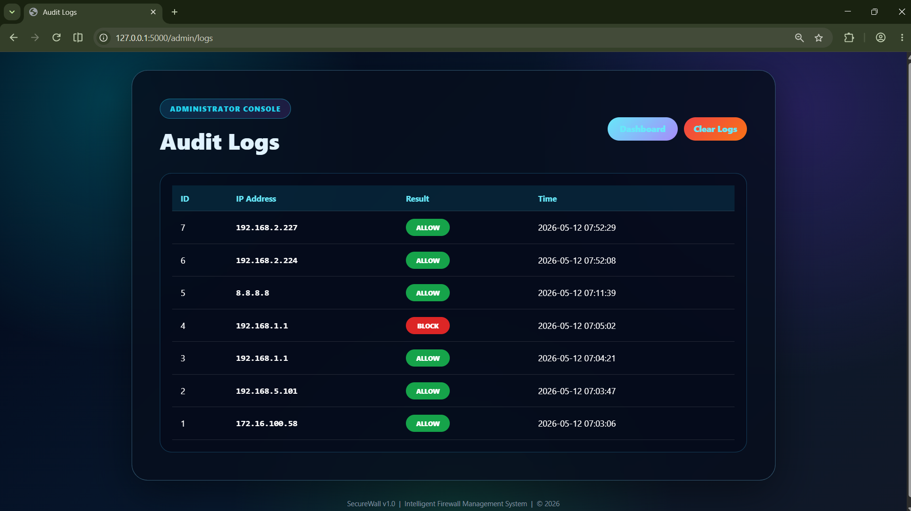
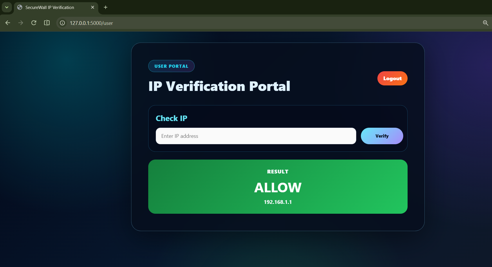

# SecureWall – Intelligent Firewall Management System

**MCA Final Year Project (MCSP-232) · Indira Gandhi National Open University (IGNOU)**


A web-based **rule-based firewall simulation system** that lets an administrator create and manage ALLOW / BLOCK rules for IPv4 addresses, and lets a user check whether an IP address would be allowed or blocked. Every check is recorded in an activity log with a timestamp.

> **Note:** SecureWall is a learning and demonstration project. It simulates firewall rule processing in a web application; it does **not** capture or filter real network traffic, and it does not use AI or machine learning. The word "Intelligent" in the title refers to the rule-based decision logic.

---

## Features

- Separate **Administrator** and **User** login paths (role-based access)
- Session-based authentication with protected routes
- Add, edit, delete, and enable / disable firewall rules
- IPv4 address validation on the server (regular expression, values 0–255)
- Rule-based **ALLOW / BLOCK** decision for any submitted IP address
- Default decision **ALLOW** when no enabled rule matches
- Automatic activity logging (IP, result, timestamp) for every valid check
- Dashboard with rule and log counters, latest log entries, and a full log page
- Clear-logs option for the administrator
- SQLite database created automatically on first run

## Technology Stack

| Technology | Usage |
|---|---|
| Python 3 | Backend logic |
| Flask | Web framework (routing, sessions, templates) |
| Jinja2 | HTML templates |
| SQLite (`sqlite3` module) | Database |
| HTML5 & CSS3 | User interface |

## Modules

**User Authentication Module**
Admin and user login, logout, session handling, and role-based access to pages.

**Firewall Rule Management Module**
Add, edit, delete, and enable / disable rules for IPv4 addresses with ALLOW or BLOCK actions.

**IP Validation Module**
Validates the IPv4 format and applies the matching enabled rule (or the default ALLOW decision).

**Firewall Logging Module**
Stores every valid check in the `logs` table and displays it to the administrator.

**Database Management Module**
Creates and upgrades the SQLite tables and runs all queries with parameterised statements.

## Database

| Table | Columns |
|---|---|
| `rules` | `id`, `ip` (unique), `action`, `enabled` |
| `logs` | `id`, `ip`, `result`, `scanned_at` |

## Security Measures

- Role-based access: separate administrator and user sessions
- Protected routes (admin and user decorators)
- Server-side IPv4 and action validation
- Parameterised SQL queries (`?` placeholders)
- Activity logging of all valid IP checks

## Screenshots

### Landing Page


### Admin Login


### User Login


###  IP Verification Portal


### Admin Dashboard – Firewall Management Console


### Admin Dashboard – Rules and Audit Logs


### Audit Logs


### IP Verification Result


## Project Structure

```
SecureWall/
├── app.py                 # Flask application (routes, validation, database logic)
├── firewall.db            # SQLite database (created automatically if missing)
├── README.txt             # Short run instructions
├── static/
│   └── style.css          # Stylesheet
└── templates/
    ├── base.html
    ├── landing.html
    ├── login.html
    ├── admin_dashboard.html
    ├── edit_rule.html
    ├── logs.html
    └── user_dashboard.html
```

## Installation

1. Clone the repository:
   ```bash
   git clone https://github.com/Thanujareddii/SecureWall-Firewall-Management-System.git
   cd SecureWall-Firewall-Management-System
   ```
2. Make sure **Python 3** is installed.
3. Install Flask:
   ```bash
   pip install flask
   ```
4. Run the application:
   ```bash
   python app.py
   ```
5. Open your browser and go to **http://127.0.0.1:5000**

The database tables are created automatically when the application starts.

## Default Login Credentials (for demonstration only)

| Role | Username | Password |
|---|---|---|
| Administrator | `admin` | `admin123` |
| User | `user` | `user123` |

> These credentials are fixed in `app.py` for classroom demonstration. Change them before using the project anywhere else.

## How to Use

1. Open the landing page and choose **Administrator Console** or **IP Verification Portal**.
2. **Administrator:** log in, add rules (IP address + ALLOW / BLOCK), edit, enable / disable or delete them, and review or clear the logs.
3. **User:** log in, enter an IPv4 address, and press **Verify** to see the ALLOW / BLOCK result.

## Limitations

- Simulation only – no live packet capture or traffic filtering
- Exact IPv4 address matching (no IP ranges / CIDR, no IPv6)
- Demonstration credentials and secret key are stored in `app.py`
- Runs on the Flask development server (`debug=True`) on a single computer

## Future Enhancements

- Password hashing and a users table
- CSRF protection and POST-based actions for delete, toggle, and clear logs
- CIDR / IP range rules and IPv6 support
- Log filtering, pagination, and export
- Integration with an operating-system firewall for real enforcement
- Intrusion detection and AI-based analysis of log patterns
- Cloud deployment with HTTPS

## Author

**Thanuja Reddy G**

MCA Final Year Project · Indira Gandhi National Open University (IGNOU)

GitHub: [https://github.com/Thanujareddii](https://github.com/Thanujareddii)
